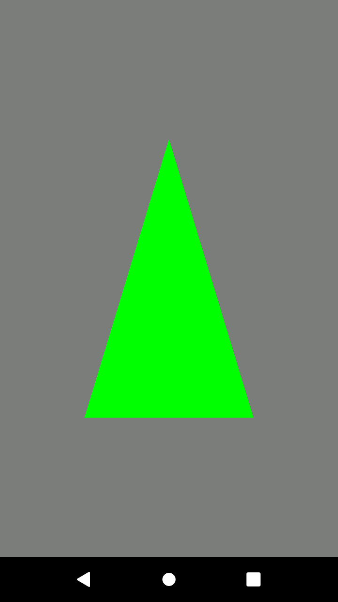
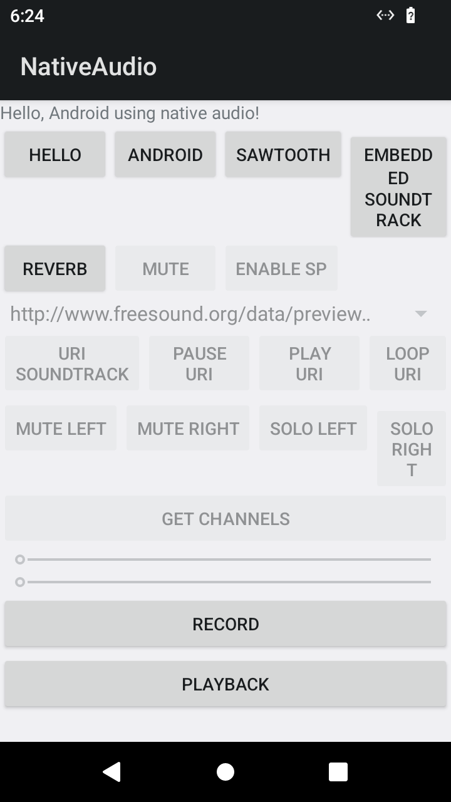

# Avaliação do runtime Android do Drunk

**Data da investigação:** 2026-10-24. **Resultado atual:** **NO-GO provisório para iniciar o runtime de produto.** O spike redroid foi executado e parcialmente demonstrado; consulte a [seção 3.2](#32-spike-redroid-executado). Isso não seleciona redroid como arquitetura do produto nem demonstra compatibilidade com Roblox. As observações iniciais de leitura abaixo são o retrato da fase anterior à execução autorizada.

**Bloqueadores:** composição de runtime adequada ao produto e inventário de licenças continuam sem conclusão. Os samples Android oficiais foram compilados e lançados: Hello GL2 desenhou o triângulo usando SwiftShader, Native Audio criou um track de reprodução com rota Android `speaker`, e um toque físico pelo viewer acionou o botão HELLO. Isso não demonstra aceleração por GPU, áudio audível no host, controles de jogo completos, bom desempenho do viewer nem encerramento gracioso. Nenhum Roblox foi instalado. O [marco para revisão](#7-primeiro-marco-para-revisão) mantém o gate de produto fechado.

A [especificação aprovada](superpowers/specs/2026-10-24-drunk-design.md), seções 5–7, exige código próprio Rust e uma composição Android/Linux demonstrada antes do produto. A decisão está na [ADR 0001](adr/0001-android-runtime-backend.md). A fase documental inicial limitou-se a fontes públicas e inspeção de leitura. O spike autorizado e registrado abaixo foi uma fase operacional separada.

## 1. Como interpretar as evidências

- **Documentado:** afirmação publicada pelo mantenedor, com link; não equivale a medição local.
- **Observado:** resultado dos comandos de leitura da seção 3, nesta máquina e nesta data.
- **Inferência:** avaliação de engenharia do Drunk, explicitamente indicada.
- **Não demonstrado:** falta evidência necessária; não deve ser tratado como aprovado.

Os links foram consultados em 2026-10-24. Páginas e branches móveis podem mudar; numa execução futura devem ser registrados commits, versões, hashes e uma cópia dos resultados utilizados. As fontes selecionadas são dos próprios projetos, documentação oficial do Google e suporte oficial Roblox. Nenhuma alegação sobre componentes internos do Sober vem de terceiros ou da inspeção de seus binários.

## 2. Limite da evidência sobre o Sober

| Afirmação | Evidência e limite |
| --- | --- |
| O repositório público serve como issue tracker | **Documentado:** [README oficial](https://github.com/vinegarhq/sober). Não oferece a implementação do runtime. |
| Sober é fechado e experimental | **Documentado:** [site oficial](https://sober.vinegarhq.org/). A existência do produto não oferece código ou uma interface de incorporação ao Drunk. |
| O runtime especializado executa a versão Android do Roblox e faz a ponte Android/Linux | **Documentado:** [FAQ oficial](https://vinegarhq.org/Sober/FAQ/index.html). É uma descrição funcional, não uma especificação de APIs ou dependências internas. |
| É possível reproduzir esse resultado combinando bibliotecas públicas específicas | **Não demonstrado.** Não foi identificado, nas fontes acima, um contrato público para tal composição. |
| Sober usa ART, um linker, uma tradução de ABI ou uma ponte gráfica específica | **Desconhecido.** Não atribuímos essas escolhas ao Sober. |

**Inferência:** Sober demonstra que seus autores oferecem esse resultado, mas não demonstra que existe um backend reutilizável, licenciável e mantido que satisfaça B. Sua instalação local, registrada abaixo, também não valida um runtime próprio do Drunk.

## 3. Inspeção local reproduzível

Estes comandos somente consultam identificação do sistema, disponibilidade de programas e arquivos. Foram executados; comandos de lançamento da seção 5 não foram.

```bash
cat /etc/os-release
uname -srmo
lscpu
lspci -nnk
printf 'Session: %s\n' "${XDG_SESSION_TYPE:-unset}"
dpkg-query -W libgl1-mesa-dri mesa-vulkan-drivers libegl-mesa0
for tool in adb emulator waydroid crosvm qemu-system-x86_64 flatpak vulkaninfo glxinfo lspci; do
    command -v "$tool" || true
done
flatpak list --app --columns=application,version
ls -l /dev/kvm /dev/dri /dev/binderfs /dev/binder
for p in "$HOME/Android/Sdk/emulator/emulator" \
    /opt/android-sdk/emulator/emulator /usr/lib/android-sdk/emulator/emulator \
    /var/lib/waydroid/images "$HOME/.android/avd"; do
    if [ -e "$p" ]; then ls -ld "$p"; else printf 'Absent: %s\n' "$p"; fi
done
```

| Campo | Resultado observado |
| --- | --- |
| Distribuição/kernel/arquitetura | Ubuntu 26.04.1 LTS; `Linux 7.0.0-38-generic x86_64 GNU/Linux` |
| CPU | Intel Core i5-2400 @ 3.10 GHz; 4 CPUs lógicas |
| Flags relevantes presentes | `lm`, `nx`, `sse4_1`, `sse4_2`, `popcnt`, `cx16`, `lahf_lm`, `vmx`, `ept`, `avx`; `lscpu` informa VT-x |
| GPU/driver de kernel | AMD/ATI Park, Mobility Radeon HD 5430/5450/5470, PCI `1002:68e0`; subsistema XFX Radeon HD 5450; driver em uso `radeon` |
| Bibliotecas gráficas instaladas | `libgl1-mesa-dri`, `mesa-vulkan-drivers`, `libegl-mesa0`: `26.0.8-1ubuntu0.3` |
| Sessão/dispositivos | `XDG_SESSION_TYPE=wayland`; `/dev/dri/card0`, `/dev/dri/renderD128` e `/dev/kvm` existem |
| Binder | `/dev/binderfs` e `/dev/binder` não encontrados nesses caminhos; isso não determina suporte compilado ou possibilidade de carregar módulos |
| Ferramentas no PATH | `/usr/bin/adb`, `/usr/bin/flatpak`, `/usr/bin/lspci`; não encontrados `emulator`, `waydroid`, `crosvm`, `qemu-system-x86_64`, `vulkaninfo`, `glxinfo` |
| Caminhos adicionais | Nenhum dos cinco caminhos do último loop existe |
| Sober instalado | O inventário Flatpak lista `org.vinegarhq.Sober` versão `1.8.0`; não foi iniciado nem inspecionado internamente |
| Runtime/imagem/API de um candidato Drunk | **Não selecionados/não medidos** |
| Backend gráfico, input, áudio, lançamento, saída, logs Android | **Não executados/não medidos** |

**Limites:** a busca não cobriu todos os diretórios do disco nem dispositivos remotos. A ausência no PATH e nos caminhos usuais não prova ausência global. A existência de `/dev/kvm` não prova acesso utilizável; pacotes Mesa instalados não provam suporte Vulkan/GLES desta GPU. Não foi executado `adb devices`: o ADB pode iniciar um servidor automaticamente ([documentação ADB](https://developer.android.com/tools/adb)). Nenhum lançamento de aplicativo Android foi realizado: não foram selecionados/preparados uma composição B e um runtime para os samples, e não há resultado de execução, log Android ou captura de janela.

**Conclusão local:** não foi identificado um candidato B pronto para demonstrar o lançamento com as ferramentas verificadas. ADB sozinho não é runtime. Mesmo uma execução bem-sucedida do Sober não serviria como prova do adaptador próprio.

### 3.1 Diagnóstico de leitura do primeiro marco

Na mesma máquina Linux descrita acima, a tarefa 3 executou `target/debug/drunk doctor` e `target/debug/drunk doctor --json`, ambos com saída bem-sucedida. O resultado foi registrado em 2026-10-24 a partir da implementação `dd4b143`. Esta seção transcreve os fatos do relatório dessa tarefa; não registra uma nova execução do protocolo Android.

| Campo do doctor | Indício observado nesta máquina |
| --- | --- |
| `os` | Linux |
| `architecture` | `x86_64` |
| `kernel` | Versão numérica `7.0`; comparação informativa com o requisito público do Sober de kernel >= 5.11 |
| `cpu_features` | SSE4.1 e SSE4.2 presentes em todos os conjuntos de flags de CPU reportados |
| `graphics_devices` | Dois nós de dispositivo DRI observados por metadados |
| `graphics_loader` | Arquivos `libvulkan.so.1`, `libEGL.so.1` e `libGL.so.1` observados em caminhos usuais |

Os seis campos retornaram `supported` nos diagnósticos dessa máquina. Esse rótulo descreve somente o indício de cada sonda, **não aprovação do gate nem compatibilidade Android/Roblox**. O doctor consulta arquivos e metadados: não executa loaders, abre dispositivos ou inicia runtime. Presença de arquivos não comprova carregamento, versão de API, aceleração, permissões ou funcionamento do driver. Nenhum caso `unknown` foi observado nessas execuções; a ausência de sondas não foi simulada.

**Premissas ainda não verificadas:** RAM disponível e compositor/versão não foram registrados; a sessão Wayland não identifica o compositor. Acesso utilizável a KVM/DRI, disponibilidade efetiva de Binder, requisitos do futuro backend, GLES/Vulkan e integração de input/áudio permanecem sem validação. Nenhuma dessas observações estabelece paridade com Sober ou viabilidade da composição B. O host é o ambiente inspecionado e usado para o spike redroid descrito na seção 3.2. Não são publicados identificadores pessoais, credenciais ou logs brutos.

### 3.2 Spike redroid executado

Após autorização explícita do usuário, `binder_linux` foi carregado e BinderFS montado no host na primeira rodada. O container temporário `drunk-redroid` foi iniciado com Docker `--privileged`, imagem Android 12 `linux/amd64` fixada por digest e ADB publicado apenas em `127.0.0.1:5555`. Não foram mapeados manualmente dispositivos Binder do host nem usados argumentos Android adicionais. O Android concluiu o boot (`sys.boot_completed=1`), reportou API 31 e ABI `x86_64,arm64-v8a`; fingerprint `redroid/redroid_x86_64_only/redroid_x86_64_only:12/SP1A.210812.016.C2/eng.frank.20240527.145941:userdebug/test-keys`, patch de segurança `2021-10-05`.

A atividade `com.android.settings/.homepage.SettingsHomepageActivity` foi aberta via ADB; um toque sintético via ADB navegou para Network & Internet. Capturas ADB em 720×1280 foram inspecionadas visualmente. Na primeira rodada, o comando Rust `redroid view` abriu uma janela `minifb` de 506×900; essa janela não foi inspecionada independentemente. O limite de tamanho foi posteriormente ajustado para 540×680 para caber no host. O usuário confirmou que viu a janela de 383×680 e clicou em HELLO; o log Android mostrou 27.400 frames entregues ao `AudioTrack`. Isso valida um toque físico básico, mas não teclado nem controle de jogo. `scrcpy` não estava instalado no sistema; uma cópia temporária foi extraída para diagnosticar captura de áudio. `view` captura screenshots a cada 250 ms (máximo teórico 4 FPS) e não é apropriado para jogos.

Em 2026-10-24, o comando Rust `redroid stream-probe --seconds 5` recebeu 1.031.795 bytes por `adb shell -T screenrecord --output-format=h264 -`, reportando 0,19 MiB/s e 386 ms até o primeiro byte. A validação identificou NALs Annex-B SPS, PPS e de imagem. Isso confirma transporte H.264 bruto do redroid Android 12 naquela tela/execução, mas não mede FPS decodificado, latência de apresentação, estabilidade prolongada nem adequação para jogos. Em uma execução separada, `redroid stream --seconds 5` decodificou um frame, abriu a janela 720×1280 e encerrou com código 0; o conteúdo da janela não foi inspecionado visualmente de forma independente. Hibernia é WIP e declara suporte apenas ao perfil Baseline. Nada disso valida Roblox, áudio ou fluidez para jogos.

Em uma repetição autorizada em 2026-10-24, o controlador Rust iniciou novamente o container com a imagem fixada; `sys.boot_completed=1` e Android 12 foram confirmados. `redroid stream --seconds 30` abriu a janela 720×1280 e permaneceu ativo até o limite configurado. Uma única amostra de `ps`, aos 28 segundos, mostrou o processo Drunk em cerca de 92% de CPU e 1,3% de memória; `screenrecord` estava em 0,4% de CPU. Isso é apenas um ponto de observação, não uma média, medição de FPS ou avaliação de fluidez. A saída numérica do código de término não foi guardada e o conteúdo visual não foi inspecionado independentemente.

Na primeira tentativa posterior, Native Audio abriu, mas o usuário não encontrou a janela de 900 px em uma tela de 768 px. Após reduzir o tamanho máximo da janela para 540×680, a origem 720×1280 abriu em 383×680; o usuário confirmou que a viu e clicou em HELLO. O log Android registrou `AudioTrack: stop(8): called with 27400 frames delivered`, confirmando o toque e a reprodução dentro do Android. A rota era `Speaker`; não se confirmou som audível no host. A amostra anterior do viewer, após cerca de 2 min 46 s, marcou 68,2% de CPU e 1,2% de memória; não é uma média de desempenho.

Em um perfil posterior de 30 s, a versão debug de `redroid view` usou 19,27 s de CPU (64,0% de um núcleo lógico); o resize Triangle da crate `image` era o hotspot dominante. O resize foi substituído por nearest-neighbor e a conversão RGBA intermediária foi eliminada quando desnecessária: debug caiu para 6,85 s (22,7% de um núcleo) e release para 1,09 s (3,6%). Uma amostra release do viewer H.264 usou 13,44 s (44,6% de um núcleo); a execução debug anterior usou cerca de 102%. São execuções únicas e não incluem medidas de FPS/latência. Veja [redroid-spike.md](redroid-spike.md#perfil-de-cpu-do-viewer).

Para áudio, foi executado scrcpy 3.3.4 extraído de pacotes oficiais, sem instalação no sistema. No redroid Android 12, `--audio-source=playback` falhou com `NoSuchFieldException: MIX_ROLE_PLAYERS`; a tentativa `--audio-source=output` não entregou stream ao gravador. Durante o teste HELLO, não houve sink-input em PipeWire/PulseAudio nem PCM aberto em ALSA. Assim, o `AudioTrack` tocou dentro do Android, mas esta imagem/configuração não ofereceu um caminho de captura observado para o host. O upstream também registra áudio como limitação conhecida e aponta a necessidade de HAL/ponte ([issue 18 do redroid](https://github.com/remote-android/redroid-doc/issues/18)). Isso não demonstra impossibilidade de adicionar áudio em outra imagem/configuração, mas a saída de áudio do protótipo segue sem validação.

Para investigar a parada, `docker container stop --time 60 drunk-redroid` retornou após 62,37 s, mas a inspeção mostrou `Exited (137)`. Repetir `drunk redroid stop` também deixou `Exited (137)`. `docker inspect` identificou `/init` como entrypoint e nenhum `StopSignal` personalizado. `adb shell reboot -p` retornou `Done`, mas o container permaneceu em execução e Android continuou acessível. **Inferência:** o init da imagem não conclui o desligamento do container ao receber o sinal Docker; ainda não há um procedimento gracioso demonstrado. A remoção manual do container, volume e imagem concluiu a limpeza. `binder_linux` continua carregado no host, mas `findmnt /dev/binderfs` não encontrou uma montagem ativa nesta verificação.

Após esse diagnóstico, `drunk redroid stop` foi ajustado para consultar o código de saída Docker e avisar quando o container precisou de SIGKILL. Uma execução de integração confirmou a mensagem `stopped after Docker forced SIGKILL (exit 137)` para este redroid; isso melhora o diagnóstico, mas não torna o encerramento gracioso.

Um ensaio inicial com mapeamentos manuais de dispositivos Binder falhou; o container funcional omitiu `--device` e criou seu próprio BinderFS interno. A montagem BinderFS do host foi preparada pelo usuário, mas sua necessidade para esse comando não foi demonstrada. Na primeira rodada, o container inicial foi criado manualmente; o controlador Rust então verificou estado/configuração, repetiu `start` idempotentemente, abriu Settings com `demo`, exibiu frames com `view` e executou `stream-probe`. Naquela limpeza, ADB também listava um endpoint adicional `emulator-5554`, que foi deixado intacto. Nas rodadas posteriores de validação, o container, volume, imagem e endpoint ADB do redroid foram removidos. A CLI não carrega módulo, monta BinderFS nem remove imagem/volume. Na última verificação, `binder_linux` continuava carregado, mas BinderFS não estava montado; ver [redroid-spike.md](redroid-spike.md).

## 4. Modelos candidatos

### 4.1 Adaptador Linux próprio consumindo componentes AOSP

Este é um **modelo de pesquisa**, não o nome de um backend pronto. A [arquitetura AOSP](https://source.android.com/docs/core/architecture) documenta framework, serviços e componentes do sistema Android. A documentação de [ABIs do NDK](https://developer.android.com/ndk/guides/abis) inclui `x86_64`. Isso confirma componentes e uma ABI, não um SDK público para executar APKs arbitrários em um processo Linux comum.

| Critério | Avaliação |
| --- | --- |
| Responsabilidade | **Proposta B:** Drunk mantém supervisor/adaptador Rust; componentes Android ficam externos. Ainda falta uma lista fechada de componentes, versões, contratos e responsáveis por correções. |
| x86-64 | ABI Android documentada; compatibilidade da composição proposta **não demonstrada**. Uma biblioteca x86-64 não fornece automaticamente o ambiente Android esperado pelo aplicativo. Esta última conclusão é **inferência**. |
| Gráficos/janela | AOSP descreve sua [arquitetura gráfica](https://source.android.com/docs/core/graphics/architecture); não foi demonstrada uma ponte dessa composição para uma janela Wayland/X11. Backend GLES/Vulkan e ciclo de vida da superfície continuam indefinidos. |
| Input/áudio | Há documentação do [pipeline de input Android](https://source.android.com/docs/core/interaction/input) e de [áudio, serviços, Binder e HAL](https://source.android.com/docs/core/audio). Tradução de eventos desktop e integração ao servidor de áudio Linux para B **não demonstradas**. |
| Privilégios/kernel | Dependem dos componentes e do contrato de IPC escolhidos. **Não determinados**; não assumir funcionamento sem Binder, permissões de dispositivo ou serviços auxiliares. |
| Manutenção/releases | AOSP publica [tags e builds](https://source.android.com/docs/setup/reference/build-numbers), incluindo Android 17/API 37. **Inferência:** manutenção do AOSP não constitui manutenção de uma composição Linux própria; esta não tem release nem suporte demonstrado. |
| Licença/distribuição | AOSP usa predominantemente Apache 2.0, com exceções, incluindo kernel GPLv2 ([licenciamento AOSP](https://source.android.com/docs/setup/contribute/licenses)). É necessário inventário por componente/artefato, avisos e obrigações aplicáveis. Nenhuma licença global da composição foi aprovada. |
| Encaixe em B | **Conceitualmente sim; tecnicamente não demonstrado.** Não autoriza reimplementar grandes partes do Android nem escrever componentes próprios em C/C++. |

**Inferência decisiva:** há documentação das partes, mas falta uma integração mínima delimitada que una instalação, execução, janela, input, áudio e encerramento. Não há base para escolher bindings ou iniciar o runtime de produto agora.

### 4.2 Waydroid como referência ou backend externo

**Documentado:** Waydroid executa um **Android completo em container Linux**, usando namespaces e uma imagem customizada baseada em LineageOS; sua página informa Android 13 ([visão geral oficial](https://docs.waydro.id/)). A [tabela AOSP](https://source.android.com/docs/setup/reference/build-numbers) associa Android 13 à API 33. Isso descreve o projeto, não uma imagem instalada ou verificada localmente.

| Critério | Avaliação |
| --- | --- |
| Responsabilidade | Waydroid administra container, imagem e integração Android. Seu [CLI público](https://docs.waydro.id/usage/install-and-run-android-applications) instala e inicia apps; um Drunk que apenas o chamasse seria uma integração com outro ambiente. |
| x86-64 | A documentação de apps alerta que APKs somente ARM não funcionam em x86-64. Usar app com ABI compatível; nenhuma tradução ARM foi selecionada. |
| Gráficos/janela | [Instalação oficial](https://docs.waydro.id/usage/install-on-desktops) requer sessão Wayland no fluxo Ubuntu/Debian; [propriedades públicas](https://docs.waydro.id/usage/waydroid-prop-options) incluem integração de múltiplas janelas. O caminho gráfico efetivo precisa ser medido. |
| Input/áudio | O [guia de diagnóstico](https://docs.waydro.id/debugging/troubleshooting) reconhece problemas de teclado físico. O [manifesto Debian upstream](https://github.com/waydroid/waydroid/blob/main/debian/control) depende de `pipewire-pulse` ou `pulseaudio`. **Inferência:** são interfaces a avaliar como parte do backend inteiro; não demonstram uma biblioteca estável embutível para Rust. |
| Privilégios/kernel | Dependência de LXC no manifesto; instalação e gestão do serviço/container incluem operações privilegiadas. O diagnóstico documenta falhas de Binder. Configuração exata do kernel e permissões mínimas ainda precisam ser verificadas para uma versão fixada. Não se assume instalação em Flatpak sem integração ao host. |
| Manutenção/releases | [Releases upstream](https://github.com/waydroid/waydroid/releases) mostra `1.6.3` como latest nesta consulta, com correções de encerramento/reboot e desativação de Vulkan no driver legado `radeon`. **Inferência:** há evidência de manutenção, mas sem garantia de suporte para nossa GPU ou prazo futuro. |
| Licença/distribuição | [LICENSE do projeto](https://github.com/waydroid/waydroid/blob/main/LICENSE) contém GPLv3. Imagens Android e dependências exigem inventário próprio; não herdam automaticamente uma licença única. Não foi aprovada redistribuição de imagem com serviços Google, Roblox ou outros componentes proprietários. |
| Encaixe em B | **Não, se usado como está por meio de seu CLI.** Isso corresponde à opção A da especificação. Extrair componentes e manter uma integração própria seria uma nova pesquisa B, sem prova nesta investigação. |

Waydroid permanece uma referência técnica útil. Selecioná-lo como backend completo exigiria uma nova decisão de arquitetura do usuário, além da validação técnica; não foi selecionado aqui.

### 4.3 Sistema Android completo em VM: Android Emulator

Representante documentado do modelo de VM completa: [Android Emulator](https://developer.android.com/studio/run/emulator), com dispositivo virtual/imagem Android. O modelo de container completo já é representado por Waydroid; não se presume equivalência entre container e VM.

| Critério | Avaliação |
| --- | --- |
| Responsabilidade | O emulador/imagem externos fornecem o dispositivo Android completo. Drunk teria responsabilidade de orquestração, não de adaptar diretamente APIs Android ao Linux. |
| x86-64 | A [documentação de aceleração](https://developer.android.com/studio/run/emulator-acceleration) descreve imagens x86/x86-64 e aceleração de VM no host compatível. A imagem concreta ainda precisa ser escolhida e fixada. |
| Gráficos/janela | O emulador oferece janela própria e renderização por hardware ou software, configurável com `-gpu`; GLES/Vulkan dependem de imagem, driver e modo. Não há medição nesta máquina. |
| Input/áudio | O frontend do dispositivo virtual fornece controles de interação; a [referência de linha de comando](https://developer.android.com/studio/run/emulator-commandline) documenta opções de áudio. O mapeamento desktop e a saída audível precisam ser demonstrados; não foi definida ponte própria Rust. |
| Privilégios/kernel | Linux usa KVM para aceleração, com virtualização de CPU e permissões apropriadas. A disponibilidade foi apenas parcialmente observada; nenhum dispositivo foi aberto nem módulo/configuração alterado. |
| Manutenção/releases | [Notas oficiais](https://developer.android.com/studio/releases/emulator) registram `37.2.12 Stable (Oct 1, 2026)`. Há manutenção publicada; isso não resolve licença, integração ou compatibilidade de um produto Drunk. |
| Licença/distribuição | Os [termos do SDK](https://developer.android.com/studio/terms), §§3.1–3.5, limitam o uso concedido e a redistribuição, preservando licenças próprias de componentes abertos. Não presumir que binários/imagens do SDK podem ser incorporados ao produto. Um build de fontes abertas exigiria inventário separado. A adequação da distribuição continua **não demonstrada**. |
| Encaixe em B | **Inferência:** um lançador do emulador completo não demonstra o adaptador especializado B. Pode servir como controle de laboratório, após resolver condições de uso; adoção como produto exige revisão da arquitetura. |

### 4.4 redroid como candidato para spike com Android externo

**Documentado:** [redroid (Remote Android)](https://github.com/remote-android/redroid-doc) descreve Android em container Linux, suporta arquiteturas `amd64` e `arm64`, publica imagens Android com variantes `64only`, e apresenta acesso de controle pelo ADB TCP (porta 5555 no exemplo). A documentação de início exige módulos de kernel `binder_linux` (com dispositivos `binder`, `hwbinder`, `vndbinder`) e `ashmem_linux`, e mostra execução Docker com `--privileged`. Ela também alerta para não expor ADB em uma rede pública. O próprio projeto informa que redroid é Apache 2.0, os módulos de kernel são GPLv2, e que componentes de terceiros incluídos precisam de análise de licença própria.

| Critério | Avaliação |
| --- | --- |
| Papel no protótipo | **Proposta de spike:** usar redroid como dispositivo Android externo ao processo Rust; Drunk poderia controlar um endpoint ADB local. Isso exercita descoberta/controle de um Android, mas não equivale a uma implementação Rust do runtime Android nem prova a arquitetura B de produto. |
| x86-64 | **Documentado:** redroid anuncia suporte `amd64`; também há tags `64only`. **Inferência:** uma imagem `64only` reduz ambiguidade de ABI para um host x86-64, mas a execução do sample ainda precisa confirmar ABI, imagem e compatibilidade reais. |
| Controle e superfície | **Documentado:** ADB pode conectar ao endpoint redroid e executar comandos Android; a documentação recomenda scrcpy para exibir/interagir com a tela. **Não demonstrado:** um contrato de janela integrado ao Drunk ou uma interface de controle nativa Rust; o spike deve registrar quais ferramentas participam. |
| Kernel e privilégios | **Documentado:** exige módulos Binder/ashmem conforme o fluxo de instalação, e o exemplo Docker usa `--privileged`. **Observado neste spike:** após autorização do usuário, `binder_linux` foi carregado e o container privilegiado iniciou sem mapear nós Binder do host. Container privilegiado tem acesso amplo ao host. |
| Segurança ADB | **Documentado:** o upstream alerta que expor a porta ADB publicamente pode comprometer container e host. **Regra proposta para o spike:** bind apenas a loopback e validar a configuração antes de iniciar. Isso reduz exposição de rede, mas não mitiga o risco do container privilegiado. |
| GPU/input/áudio | Hello GL2 foi lançado e desenhou o triângulo. O renderer reportado foi `ANGLE (Google, Vulkan 1.2.0 (SwiftShader Device ...))`: caminho GLES funcional em renderização por software, sem aceleração da GPU física demonstrada. Um toque físico pela janela Drunk acionou HELLO; o Android registrou 27.400 frames entregues ao AudioTrack. A rota Android era `Speaker`, sem underruns na inspeção; audibilidade no host não foi confirmada. Teclado e controle de jogo permanecem não testados. |
| Licenças e manutenção | A imagem redroid foi fixada por digest e os samples foram obtidos do repositório oficial Android NDK Samples sob Apache 2.0. Isso não substitui inventário de componentes da imagem, revisão completa de dependências nem decisão de condições de distribuição. Não redistribuir os APKs de teste sem revisar avisos/licenças. |
| Encaixe na arquitetura de produto | **Avaliação:** redroid como está fornece Android completo em container e, portanto, se aproxima da alternativa de Android externo completo, não prova por si só o runtime próprio em Rust imaginado no desenho B. O usuário autorizou um protótipo de laboratório com Android externo; adoção como produto continua sujeita a decisão de arquitetura e ao gate desta ADR. |

**Limite de escopo do spike:** após a autenticação `sudo` interativa no terminal aberto, testar somente um app Android de teste permitido, começando por Native Audio e Hello GL2 conforme a seção 5. O resultado pode demonstrar controle ADB e caminhos básicos de app/renderização/áudio, não Roblox. Não buscar, instalar ou executar Roblox durante esse spike; não modificar apps nem contornar attestation, integridade, controles de plataforma ou restrições do jogo.

## 5. Protocolo manual — execução parcial

**Execução redroid:** `binder_linux` foi carregado após autorização do usuário e o container temporário usou Docker `--privileged`. A imagem foi fixada por digest e ADB restrito a loopback. `ashmem_linux` não foi carregado separadamente; não presumir que esse resultado se aplique a outras imagens ou versões.

### Aplicativos e preparação

Aplicativo de áudio: **Native Audio**, do repositório oficial [android/ndk-samples](https://github.com/android/ndk-samples/tree/main/native-audio). Ele reproduz/grava áudio por JNI/OpenSL ES; seu [README](https://github.com/android/ndk-samples/blob/main/native-audio/README.md) informa que OpenSL ES está depreciado e que o player URI tem problema conhecido. Nesta execução, apenas o botão de reprodução local “HELLO” foi acionado; o microfone não foi autorizado nem usado. A [licença Apache 2.0](https://github.com/android/ndk-samples/blob/main/LICENSE) cobre o sample sob suas condições. Preservar licença, avisos e licenças das dependências da revisão escolhida.

Complemento gráfico: **Hello GL2**, do mesmo repositório/licença, cujo [README](https://github.com/android/ndk-samples/blob/main/hello-gl2/README.md) descreve um triângulo GLES 2.0 com atividade Java e JNI. Ele verifica um caminho gráfico básico, não GLES 3, Vulkan ou Roblox. Os aplicativos são artefatos de terceiros usados como sondas externas, não código C/C++ mantido pelo Drunk.

Foram usados commit upstream `abb0d8ef36a5ee1be5cebc67025678f42970c393`, Temurin JDK `21.0.13+9`, Gradle `8.13`, Android SDK Platform `35`, NDK `29.0.14206865` e CMake `4.1.0`. `:hello-gl2:app:assembleDebug` e `:native-audio:app:assembleDebug` terminaram com `BUILD SUCCESSFUL`; os APKs incluem ABI `x86_64` (também arm64-v8a, armeabi-v7a, riscv64 e x86). Os dois foram assinados pelo certificado Android Debug SHA-256 `a9e8543bf88e5d54eb39a6dd99595774c6ce760f683620d56475864951e393ea`.

| Sample | Pacote/atividade | min/target API | SHA-256 do APK |
| --- | --- | --- | --- |
| Hello GL2 | `com.android.gl2jni/.GL2JNIActivity` | 21/35 | `2735202b82b9efb8d5ba3046ec3ac62127b6b0118521df0f6ca6d071352eccde` |
| Native Audio | `com.example.nativeaudio/.NativeAudio` | 23/35 | `87a63dd6f40f26f6a38560af58e8b5e9fbbaaa14ea5c56289996bb68baa0ab7f` |

Os APKs, a cópia do repositório e o JDK de teste permanecem temporariamente em `/tmp/drunk-android-ndk-samples` e `/tmp/drunk-jdk21`; não fazem parte do Drunk nem serão distribuídos. Capturas Android locais estão em [`docs/evidence`](evidence).





### Registro obrigatório por execução

| Grupo | Campos a preencher; estado nesta investigação |
| --- | --- |
| Host | Data, distro, kernel, arquitetura, CPU/flags, RAM, GPU/PCI, driver de kernel e userspace, sessão/compositor; identificação parcial na seção 3 |
| Runtime | redroid Android 12, imagem digest `a6c464…64e2`, API 31, ABI `x86_64,arm64-v8a`, patch 2021-10-05; fingerprint completo na seção 3.2 |
| Licenças | redroid e imagem/dependências ainda sem inventário completo; NDK samples Apache 2.0; distribuição da composição **não aprovada** |
| Aplicativos | Ambos compilados/instalados/lançados; commit, toolchain, pacote, APIs, hash e assinatura acima |
| Gráficos | Hello GL2 visível; GLES 3.1 via ANGLE/Vulkan SwiftShader, renderização por software; aceleração física **não demonstrada** |
| Interação | Toque sintético ADB em Settings; um toque físico em HELLO via janela Drunk disparou reprodução Android (27.400 frames). Teclado e controle de jogo não testados. Saída audível no host **não confirmada**; RECORD_AUDIO permaneceu negada |
| Ciclo de vida | Hello GL2 e Native Audio permaneceram abertos por 60 s e foram encerrados/relançados duas vezes cada; stop Docker resultou exit 137 até com timeout de 60 s; parada graciosa e estabilidade prolongada do stream **não demonstradas** |
| Evidências | Capturas Android da tela GL2 e Native Audio em `docs/evidence`; logs/saídas resumidos nesta seção, sem tokens ou credenciais |

### Sequência e critério de aprovação

1. **Parcial:** inspeção do host/runtime/sample e versão/hash registrados acima. Falta composição B de produto delimitada, com interfaces, dependências, manutenção e licenças.
2. **Executado para o spike redroid:** container fixado iniciado e Android 12 inicializado. Não foi executada VM de controle; isso não valida B.
3. **Executado para redroid:** serial `127.0.0.1:5555` selecionado; propriedades, instalação de APKs, resolução de atividades e lançamento registrados. Não presumir que ADB representa a interface de produto de um adaptador B.
4. **Parcial:** Native Audio abriu e a reprodução “HELLO” criou um track Android com rota `speaker`; saída audível no host e foco/teclado não foram verificados. Hello GL2 desenhou o triângulo e reportou ANGLE/SwiftShader; renderização é software, não GPU física. Capturas estão em `docs/evidence`.
5. **Parcial:** cada app permaneceu aberto por 60 s e foi encerrado/relançado duas vezes; processo e atividade foram observados e não houve `FATAL EXCEPTION` nos logs filtrados. Alternância de foco não foi testada. A parada via Docker terminou em 137 mesmo com timeout de 60 s, portanto não foi controlada graciosamente.
6. **Parcial:** logs filtrados do GL2/Android e estado AudioFlinger foram consultados; as capturas PNG foram guardadas. Logs completos com horários por ciclo, saída integral do supervisor e inventário de processos ainda não foram preservados.
7. O marco de protótipo externo continua **NO-GO**: ainda faltam desempenho aceitável, controles de jogo completos, aceleração gráfica, áudio audível no host, parada confiável, repetibilidade e revisão de composição/licenças. Um toque básico pela janela já foi demonstrado. Manter **NO-GO de produto** até decisão separada sobre arquitetura, composição, manutenção/distribuição e licenças. Sucesso dos samples não prova compatibilidade com Roblox.

O protocolo de Waydroid seria `waydroid app install CAMINHO_APK` e `waydroid app launch PACOTE`, segundo o CLI citado. Só constitui avaliação de referência/opção A; não é uma alternativa silenciosa ao gate B. Para redroid, o protocolo upstream usa conexão ADB ao endpoint local e comandos `adb -s SERIAL ...`; confirmar identidade/serial antes de cada ação e remover qualquer APK de teste após a coleta se a licença/origem assim exigir.

### Validação posterior separada do Roblox

Roblox declara oficialmente que **Linux não é suportado** nos [requisitos de sistema para computador](https://en.help.roblox.com/hc/en-us/articles/203312800-Computer-Hardware-Operating-System-Requirements). O suporte móvel Android exige Android 8.0+ e OpenGL ES 3.0, segundo os [requisitos Roblox Mobile](https://en.help.roblox.com/hc/en-us/articles/203625474-Roblox-Mobile-System-Requirements); cumprir esses mínimos não garante que um container seja suportado.

Roblox também documenta que certos jogos podem exigir Android Remote Attestation e que emuladores/dispositivos virtuais são tratados como não confiáveis; criadores podem restringir jogos individuais por esse requisito ([FAQ oficial de Android Remote Attestation](https://en.help.roblox.com/hc/en-us/articles/49648939984916-Android-Remote-Attestation)). **Inferência:** redroid provavelmente não satisfaz uma exigência que dependa de hardware/boot verificado de um aparelho físico. Nenhum teste pode converter essa incerteza em promessa de compatibilidade. Não contornar, falsificar ou enfraquecer attestation, integridade, verificações de plataforma ou critérios definidos por criadores.

Somente após revisão separada do gate técnico, definir e documentar uma origem oficial permitida do aplicativo, identidade do editor/assinatura, versão, ABI e integridade do bundle. O ponto de entrada oficial é o [site de download Roblox](https://www.roblox.com/download). **Nenhum método de obtenção automatizada ou redistribuição do APK foi aprovado aqui.** Se não houver método permitido e verificável para o ambiente escolhido, interromper esta fase.

Se essa validação vier a ser autorizada e houver método permitido, usar o aplicativo oficial **sem modificações**, em uma execução separada com a mesma ficha de ambiente. O usuário conduz autenticação; registrar apenas resultados necessários de inicialização, login, entrada em experiência, gráficos/input/áudio e saída, removendo segredos dos logs. Rejeição por integridade, anti-cheat, attestation ou bloqueio de plataforma deve ser registrada como incompatibilidade. Não alterar APK, simular integridade, contornar verificações nem prometer acesso a experiências. Estas são restrições do projeto, não uma alegação de compatibilidade ou permissão concedida pelo Roblox.

## 6. Resultado do gate e condições para reabertura

| Requisito | Resultado |
| --- | --- |
| Evidência pública do Sober delimitada | Concluído, seção 2 |
| Comparação de modelos com fontes primárias | Concluído, seção 4; lacunas explícitas |
| Candidato de spike Android externo x86-64 | redroid iniciado; Android 12 e atividade Settings observados parcialmente, seção 3.2 |
| Autorização para carregar `binder_linux` e usar Docker privilegiado temporário | Concedida pelo usuário e exercida para o spike |
| Estado do laboratório | Container, volume, imagem e endpoint ADB temporários removidos; `binder_linux` continua carregado, sem montagem ativa em `/dev/binderfs`; ver `redroid-spike.md` |
| Backend de produto concreto e sustentável | **Não demonstrado** |
| Licenças de uma composição selecionada | **Não demonstradas**; não há composição selecionada |
| Janela e APKs de teste externos | Viewer H.264 abriu; Hello GL2 e Native Audio oficiais foram compilados, instalados e lançados; capturas Android inspecionadas em `docs/evidence` |
| Gráficos/áudio/input | Triângulo via ANGLE/SwiftShader (software); toque físico em HELLO gerou 27.400 frames de AudioTrack em rota Android `Speaker`; sem confirmação de som no host nem controle de jogo completo |
| Protocolo manual reproduzível | Executado parcialmente, seção 5; faltam alternância de foco, teclado/controle de jogo, áudio audível no host, aceleração gráfica, parada confiável, estabilidade prolongada do viewer e logs completos |
| Decisão | **NO-GO provisório** para produto; viewer mostrou uma amostra de 92% CPU e o container saiu 137; composição/licenças e Roblox não validados |

Para reabrir o gate de produto: apresentar lista de componentes/versionamento e interfaces públicas, distribuição compatível com suas licenças, responsáveis pela manutenção e evidências completas do protocolo em uma máquina Linux x86-64. Um protótipo redroid pode fornecer evidência de um Android externo, mas não comprova a arquitetura de produto B. Se a única composição funcional for um Android completo pronto (redroid, Waydroid ou outro), apresentar essa arquitetura ao usuário antes de adotá-la como produto. Não há justificativa para começar runtime Roblox, ponte gráfica final ou instalador enquanto esse gate permanecer aberto.

## 7. Primeiro marco para revisão

**Decisão técnica revisável em 2026-10-24: NO-GO provisório para produto; backend de produto selecionado: nenhum.** O spike redroid externo iniciou Android 12, conectou via ADB, abriu Settings, aceitou toque sintético e forneceu frames a uma janela Rust. Após limitar a janela para caber no host, um toque físico em HELLO entregou 27.400 frames ao AudioTrack Android em rota `Speaker`; não se confirmou saída audível no host. Hello GL2 desenhou o triângulo por ANGLE/SwiftShader software. Dois APKs oficiais foram instalados; o microfone permaneceu negado. Uma amostra do viewer indicou cerca de 92% de CPU; a parada Docker terminou em exit 137. Isso não seleciona redroid para o produto. Controles de jogo completos, aceleração da GPU física, áudio audível, parada graciosa, estabilidade prolongada e compatibilidade Roblox continuam não demonstrados. Não foi demonstrada impossibilidade de B, paridade com Sober ou compatibilidade Roblox. Roblox declara Linux não suportado e avisa que certos jogos rejeitam emuladores/dispositivos virtuais por attestation.

O gate de produto permanece fechado: falta uma composição B delimitada, com interfaces, versões, manutenção e licenças resolvidas. O spike comprovou boot Android 12, ADB, abertura de Settings, toque sintético, um toque físico no viewer que acionou Native Audio, recepção de screenshots numa janela desktop e execução dos samples GL2/áudio, mas não streaming fluido, aceleração gráfica física, áudio audível no host, controle de jogo completo, parada graciosa, estabilidade prolongada, relançamento controlado ou integração de uma experiência ao Drunk.

**Ponto de parada:** o spike autorizado foi executado parcialmente com Settings e samples Android integrados ao laboratório. O trabalho de produto continua parado até revisão de arquitetura e evidências suficientes. Não iniciar runtime Roblox, obter/instalar seus pacotes nem criar pontes finais de gráficos/input/áudio, integração desktop, Flatpak, instalador completo ou ciclo de vida das sessões sob esta autorização limitada.

**Decisão de desenho que exigiria o usuário:** o usuário autorizou o protótipo externo, inclusive carregar `binder_linux` e usar temporariamente container privilegiado. As ações de laboratório foram executadas. Adoção de redroid como arquitetura de produto exige decisão específica após apresentação do resultado. Waydroid ou outro Android completo também requer essa decisão. Revisar este marco não transforma indícios do host nem sucesso de samples em compatibilidade Roblox ou aprovação do produto.
